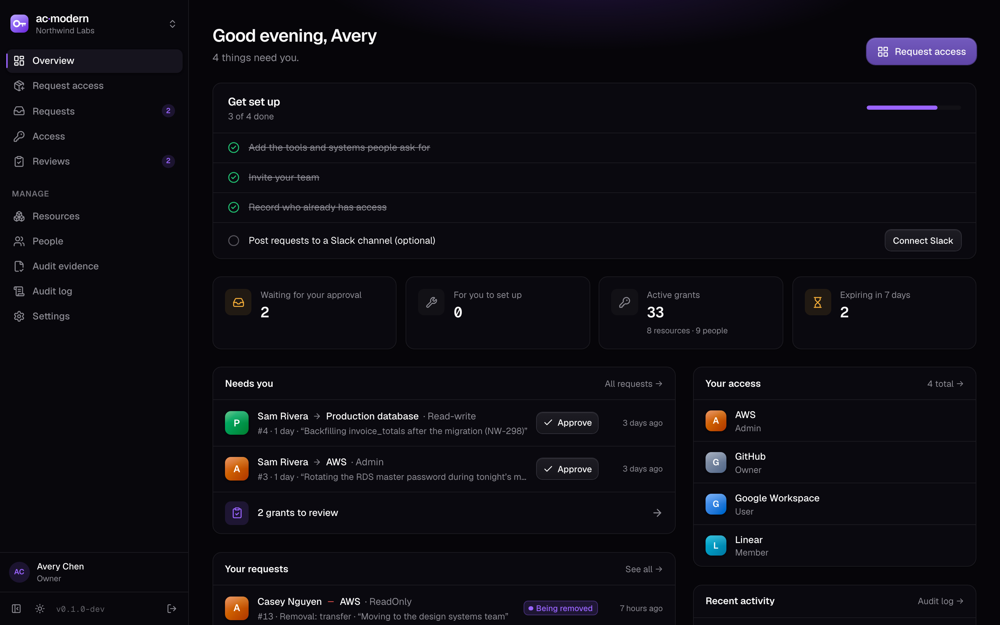
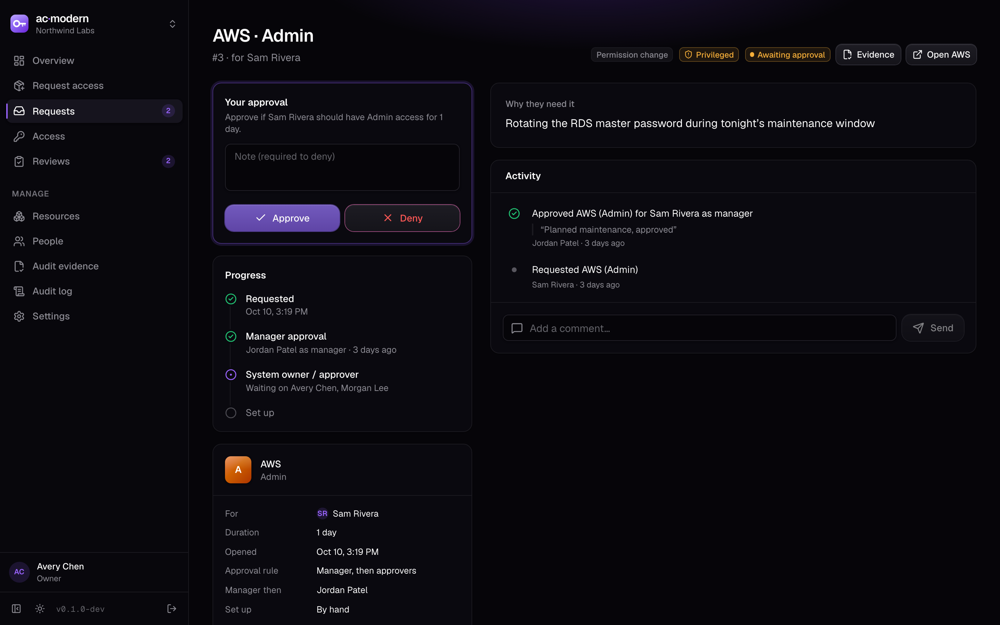
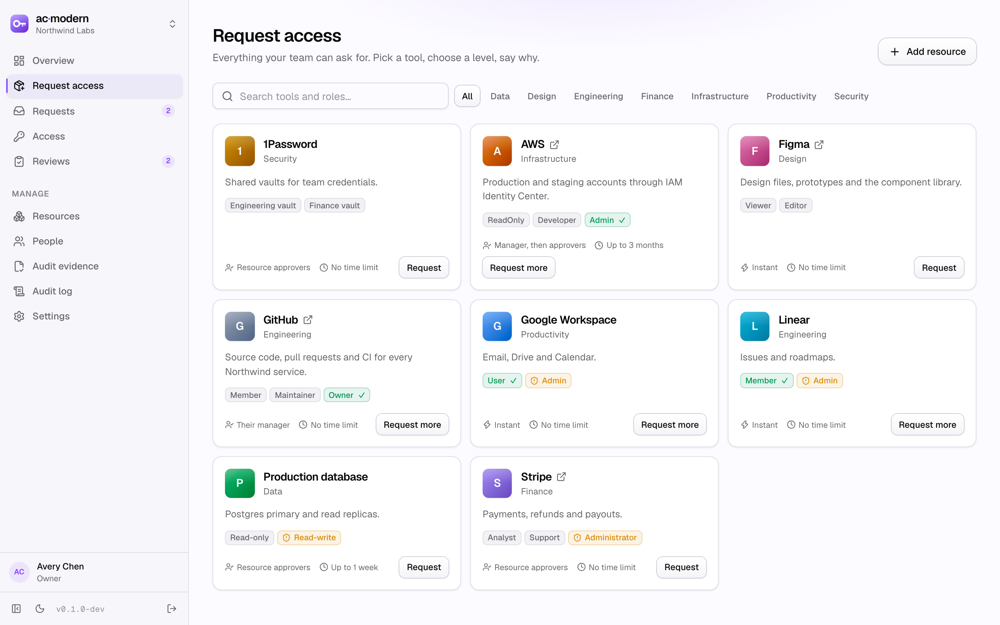
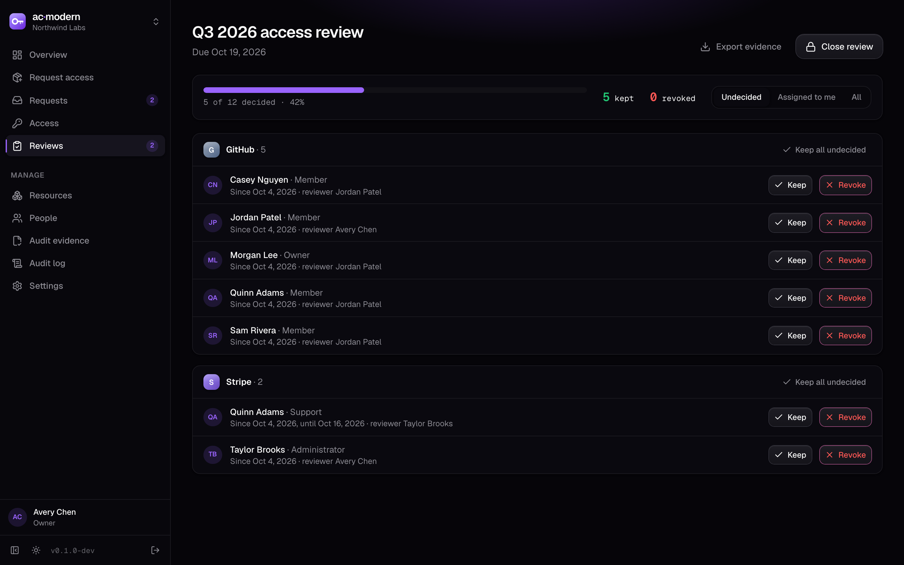
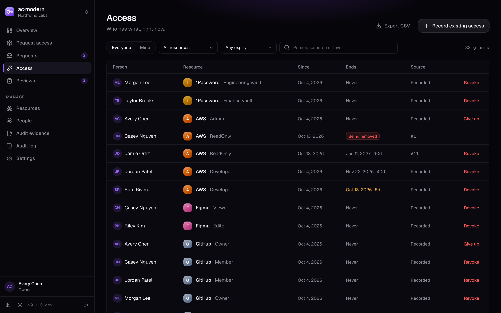

<p align="center"></p>

<h1 align="center">ac·modern</h1>

<p align="center">Access requests, approvals and reviews for small teams.<br>Self-host it in one container, or run it as a hosted service.</p>



Small teams usually handle access in Slack DMs and a spreadsheet, or pay for a helpdesk suite they don't need. ac·modern sits in between: people ask for the access they need, the right person approves it, someone (or a webhook) sets it up, and it expires on time. You always know who has what.

## What it does

- **Catalog.** Every app and system people can request, with access levels (e.g. GitHub *Member / Maintainer / Owner*).
- **Approvals.** Per resource: none, the requester's manager, resource approvers, or manager *then* approver. Nobody approves their own access, unless nobody else could (a one-person team); that case is logged as self-approved.
- **Setup.** By hand (the fulfiller gets a task and marks it done) or by **webhook**: a signed POST to your script, n8n, Zapier or Lambda. A 2xx answer completes the request. A failure falls back to a person.
- **Time-boxed access.** Max and default durations per resource. Expired grants open a removal automatically, and people get a reminder before expiry with a one-click *Extend*.
- **Access reviews.** Quarterly-style campaigns: each resource owner keeps or revokes every grant, and revoked ones become removals. Export the decisions as CSV evidence (SOC 2, ISO 27001).
- **Offboarding.** One click deactivates the person, cancels their open requests, and opens a removal for everything they hold.
- **Record existing access.** Import what people already have, so reviews and offboarding cover it from day one.
- **Audit log** of every request, decision, grant and setting change, exportable as CSV.
- **Notifications** by email (SMTP) and to a Slack channel (incoming webhook).
- **Directory sync** from your IdP: SCIM 2.0 push (Okta, Entra ID, JumpCloud, OneLogin, Rippling) or scheduled pulls from Google Workspace, the Okta API and Microsoft Graph. People are added with title and manager, and deactivation in the IdP offboards them (opening removals for all their access). IdP groups map to ac·modern admins, or to access levels, so access that already lives in the IdP is detected and tracked. Access granted there without a request is flagged in the audit evidence.
- **API for GRC tools.** Read-only, org-scoped tokens and a REST API (`/api/v1`, OpenAPI at `/api/v1/openapi.json`) for Vanta, Drata, Secureframe or your own scripts: users, resources, access, requests with approvals (the audit population), reviews and the audit log.
- **Single sign-on (OIDC)** per organisation: Okta, Entra ID, Google, JumpCloud, Authentik, Keycloak. Email domains are claimed per org (DNS-verified in the cloud), accounts are created on first sign-in, and SSO can be required, with owners keeping a password as a break-glass.

| | |
|---|---|
|  |  |
|  |  |

## Audit evidence

Built for the control auditors test as *"a process to request and approve user accounts and permissions"*, where they sample new-hire access, transfers, new admins and extra permissions (databases, repositories) and ask for the approval ticket.

- **Every change is a request** with a business justification, including onboarding (one batch for a new hire's starting access) and transfers (new access requested and old access removed together, with a new manager and title).
- **Documented approval from the system owner or manager.** Each approval records who approved, in what capacity (manager, system owner, designated approver, admin fallback, admin override, self) and when. Privileged levels (admin, owner, read-write to production) always need the system owner or an approver, even on pre-approved or manager-only resources. Admin overrides are off unless you allow them.
- **Snapshots.** The person, their title and manager, the resource, its owner and the level are frozen when the request is made, so a ticket reads the same after renames and reorgs.
- **Audit evidence page:** the population for any period (CSV), filterable by type (new hire, transfer, permission change, additional access, extension, removal), privileged-only and exceptions-only. It prints tickets one per page (save as PDF) with the approval table, provisioning after approval, full history and a SHA-256 fingerprint of the record. It also lists access recorded outside requests, ac·modern admin changes and control changes, and gives a written control description generated from your settings.

## Self-hosting

```sh
docker compose up -d
# open http://<host>:3040 and create your organisation
```

One container, no other services needed. Data lives in a SQLite file in the `/data` volume, with a generated `secret.key` that encrypts stored secrets (Slack URL, webhook signing keys). Back up both, or set `ACM_SECRET_KEY`. To use Postgres instead, set `ACM_DATABASE_URL=postgres://…` (there's a commented service in `compose.yaml`). All settings are in [`.env.example`](.env.example).

## Hosted (cloud) mode

`ACM_MODE=cloud` turns on `/signup`. Anyone (or only addresses matching `ACM_SIGNUP_ALLOW`) can create an organisation. One account can belong to several organisations and switch between them from the sidebar. Every table is scoped by `org_id`, and a test checks that one organisation can't read or act on another's data. Use Postgres in this mode.

## Webhook fulfillment

```
POST <your url>
content-type: application/json
x-acm-event: access.grant | access.revoke
x-acm-timestamp: <unix seconds>
x-acm-signature: sha256=<hex HMAC-SHA256(secret, timestamp + "." + body)>

{ "event": "access.grant",
  "request": { "id": "…", "number": 42, "reason": "request", "url": "https://…/requests/42" },
  "user": { "id": "…", "email": "dev@acme.com", "name": "Dev" },
  "resource": { "id": "…", "name": "GitHub" },
  "role": { "id": "…", "name": "Member" },
  "durationDays": 30, "grantId": null }
```

Answer 2xx once access is in place. Anything else (or a timeout after 15 s) leaves the request open for the fallback people, who can retry from the request page.

## Development

```sh
pnpm install
pnpm dev                                   # setup wizard at http://localhost:5173
ACM_DATA_DIR=./demo-data pnpm seed         # demo org: avery@northwind.example / demo-password
pnpm test                                  # workflow tests on SQLite
TEST_DATABASE_URL=postgres://… pnpm test   # same tests on Postgres
pnpm check
pnpm screenshots                           # regenerates docs/screenshots from demo data
```

Stack: SvelteKit (adapter-node), Svelte 5, Tailwind 4, TypeScript, Node 24 (built-in `node:sqlite`) or `pg`. The UI uses the same theme as pg·modern and octo·modern.

Code map: `src/lib/server/requests.ts` is the workflow (approval steps, fulfillment, revocation, webhooks), `grants.ts` covers grants, expiry and offboarding, `reviews.ts` the review campaigns, `db.ts` the SQLite/Postgres layer, and `schema.ts` the migrations.

## License

Apache-2.0
